<div align="center">

# TagViewer

### 本地 AI 出图的「提示词加工厂」

把一堆散落的 PNG，变成能搜、能改、能复用的提示词资产。

`v2.3.1` · Windows x64 · Electron + Vue 3 · MIT · 全程本地，默认离线

[English](README.en.md) · [📦 下载安装包](https://gitee.com/klanf/tag-viewer/releases) · [🎬 2 分钟上手视频](https://www.bilibili.com/video/BV19ZaD67EMs/) · [🚀 新手上手](docs/新手上手.md) · [🛠️ 开发手册](docs/开发手册.md)

</div>

这个项目里，很多功能是我一直在用的：

1. **看图时顺手 ban 掉不想要的 tag**。大家都知道筛选可以导出提示词，但是这个导出有个缺点：会把图片原本附带的各种颜色的词也带上（如：红色头发的妃咲）。所以有个黑名单的功能可以把这些颜色的词都过滤掉，但是 tag 的数量太多了，所以我就加了个 tag 页，让你在看图的时候可以顺手 ban 掉某些 tag，这样子就增加出图的随机性了（我 ComfyUI 弄了个加载 txt 文件然后随机读取的节点）。
2. **查重**。目前还自带了一个查重的功能。大家手里如果有很多那种差分图片就知道为什么这个功能很重要了，这个查重是根据 tag 查重的，比其他哈希查重的方法好点。
3. **替换规则**。如果你还想给提示词追加特定提示词的话（如给所有的角色都带上猫耳朵，猫尾巴，各种奇怪的插件），可以使用替换的规则，它允许你在特定提示词后面增加那你要补充的提示词。
4. **角色购物车**。系列这里可以把你想要出的角色加入购物车，然后一键导出成 txt 文件，搭配 ComfyUI 加载 txt 文件然后随机读取的节点就可以实现不同角色 + 不同提示词随机出图了。

## 目录

- [它是什么](#它是什么)
- [先看效果](#先看效果)
- [主线：一张图会经历什么](#主线一张图会经历什么)
- [四条主流程](#四条主流程)
- [导出管线：10 步，顺序不能换](#导出管线10-步顺序不能换)
- [功能全景](#功能全景)
- [页面与路由](#页面与路由)
- [数据、隐私与网络边界](#数据隐私与网络边界)
- [快速开始](#快速开始)
- [常用设置](#常用设置)
- [常见问题](#常见问题)
- [已知边界](#已知边界)
- [开发与验证](#开发与验证)
- [许可证](#许可证)

> 📦 **想直接装？** [Gitee Releases](https://gitee.com/klanf/tag-viewer/releases) 有安装包与绿色包；
> [GitHub 仓库](https://github.com/klanf/tag-viewer) 是源码镜像，GitHub Releases 暂未启用。

---

## 它是什么

**一句话：它站在「图库」和「出图工具」中间，不是又一个看图软件。**

```text
本地图库  →  标签库（可检索、可纠错）  →  提示词仓库（可组合、可自动导出）  →  ComfyUI
```

它解决四件事：

| 需求 | 没有它的时候 | 它怎么做 |
| --- | --- | --- |
| **找图** | 几万张图只能靠文件夹和肉眼翻 | 标签检索，中英文都行；角色 / 系列 / 分类逐层下钻 |
| **入库** | 下载的图没有提示词，等于一堆死文件 | 有 ComfyUI 元数据就直接解析；没有就用 WD14 反推打标 |
| **整理** | 重复图、认错角色、分错系列、封面乱 | 查重、角色纠正、分类管理、自定义封面、安全过滤 |
| **喂下游** | 每次出图都要手动拼词、手动导出 | 角色购物车、附加标签、清单、自动导出、替换规则、黑名单 |

**适合谁**：用 ComfyUI / SD / Anima 在本地出图，图库已有几千到几万张的动漫向创作者；以及喜欢把图库归档、去重、修标签的整理党。

**不适合谁**：只想快速看图的人（用 IrfanView / Honeyview 更轻）；需要多人协作或云同步的团队（这是单机本地工具）；完全不在意标签、只把图丢进模型的人。

---

## 先看效果

> 下面 13 张全部摄于 v2.3.1，拍摄环境是**真实库的沙箱副本**（截图脚本不碰你的数据），
> 🛡 安全模式开到最严的 `edge` 档，界面上的本机路径在按快门前统一洗成 `图库/…`。
> 注意安全模式只过滤**显示层**：角色封面是历史上自动挑的、存在库里，
> 所以系列 / 角色 / 购物车这三张里的封面在按快门前统一做了模糊。这只是截图效果，
> 软件里看到的仍是正常封面；想自己换封面见下面的「封面」一节。

<table>
  <tr>
    <td align="center" width="50%"><b>看板：来源胶囊 + 🛡 安全模式 + 无限滚动真比例网格</b><br/>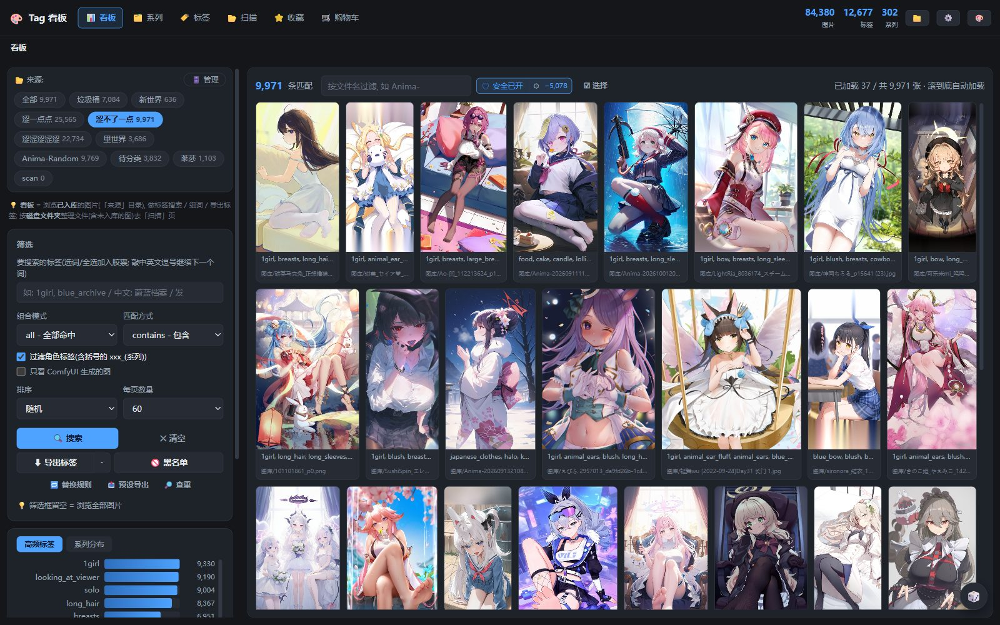</td>
    <td align="center" width="50%"><b>点一个标签 → 就地叠一层标签图集（不换页）</b><br/>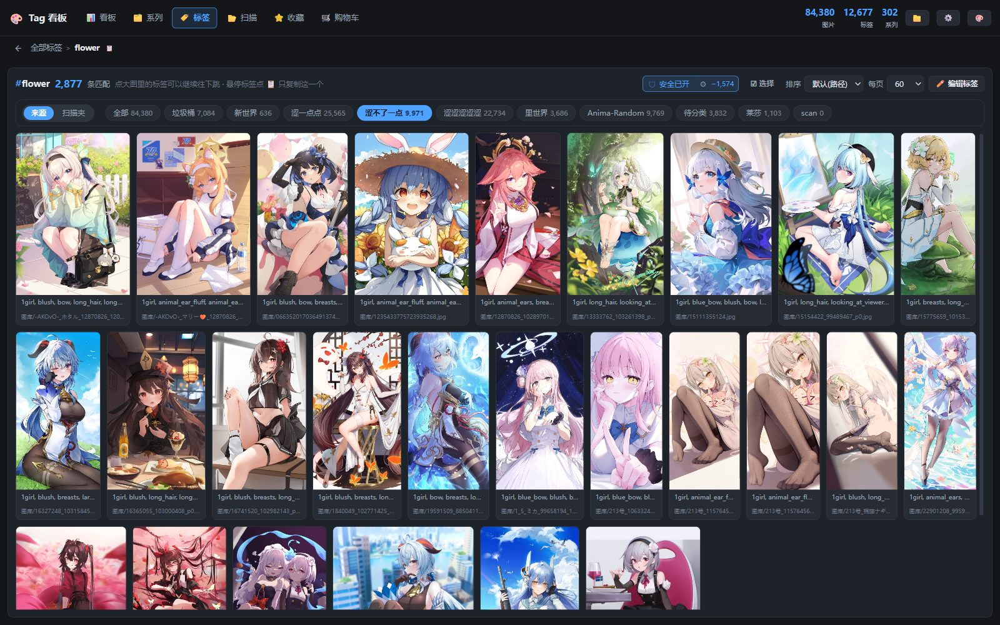</td>
  </tr>
  <tr>
    <td align="center"><b>标签总表：中英对照 + 命中数，看图顺手 ban</b><br/>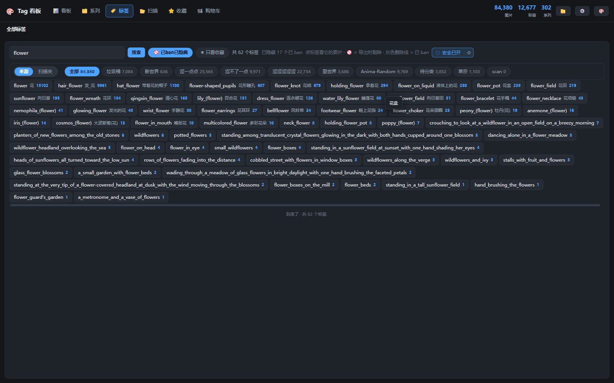</td>
    <td align="center"><b>光箱：中英双标签、命中黑名单提示、逐 tag 复制 / 入车 / ban</b><br/>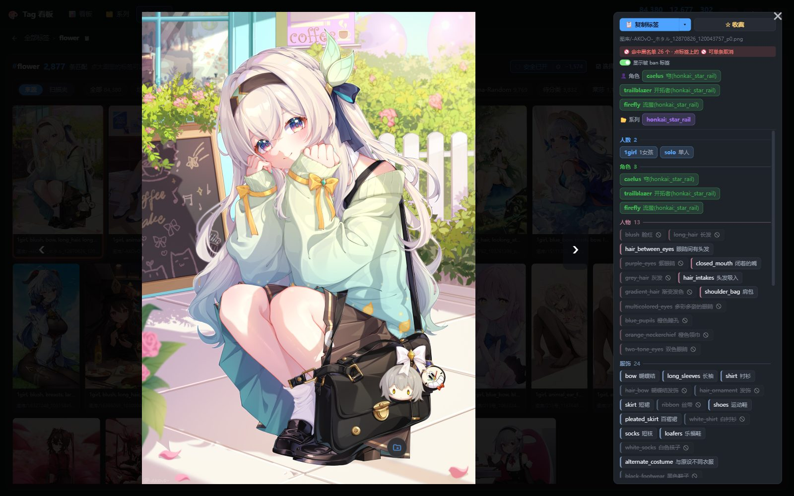</td>
  </tr>
  <tr>
    <td align="center"><b>系列墙：作品卡片带角色数与图数</b><br/>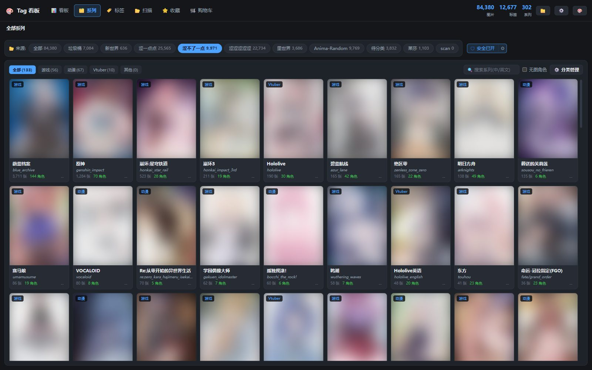</td>
    <td align="center"><b>点进作品 → 该系列的角色页，每张卡带 🛒</b><br/>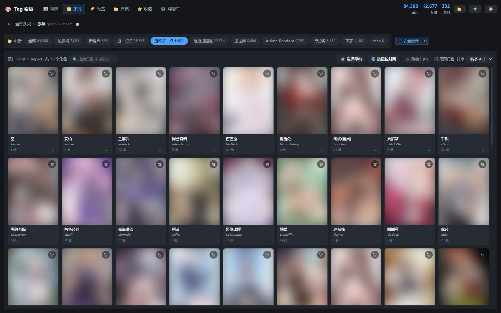</td>
  </tr>
  <tr>
    <td align="center"><b>购物车：按系列分组、附加标签、一键导出 txt</b><br/>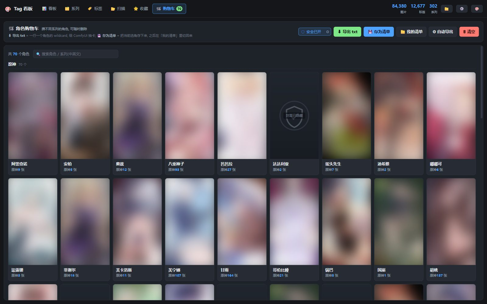</td>
    <td align="center"><b>按标签查重：一组疑似重复 + 为什么保留这张</b><br/>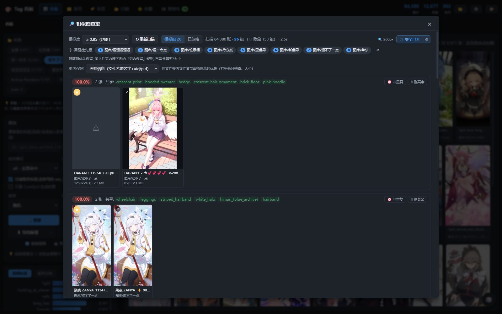</td>
  </tr>
  <tr>
    <td align="center"><b>导出预设：筛选快照 + 目标目录 + 自动导出</b><br/>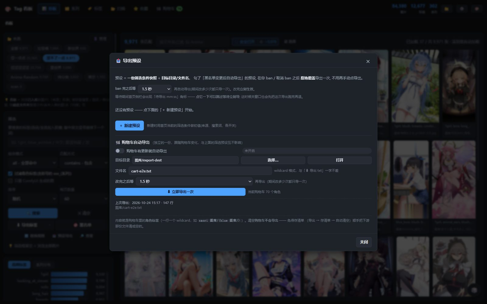</td>
    <td align="center"><b>替换规则构建器：第一行就是导出结果预览</b><br/>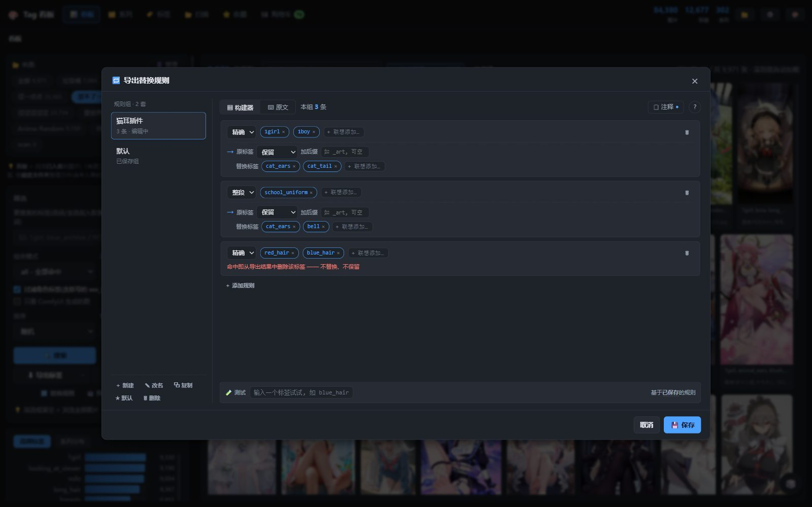</td>
  </tr>
  <tr>
    <td align="center"><b>设置抽屉：反推环境 / 在线封面 Key / 外部程序</b><br/>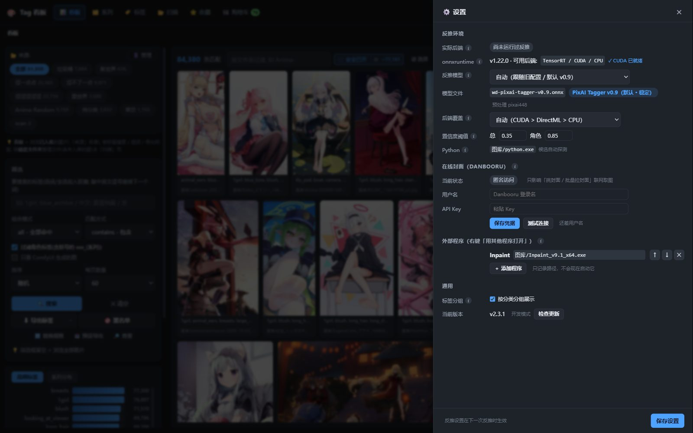</td>
    <td align="center"><b>来源管理：一个文件夹一个用途，来源与扫描夹两个开关</b><br/>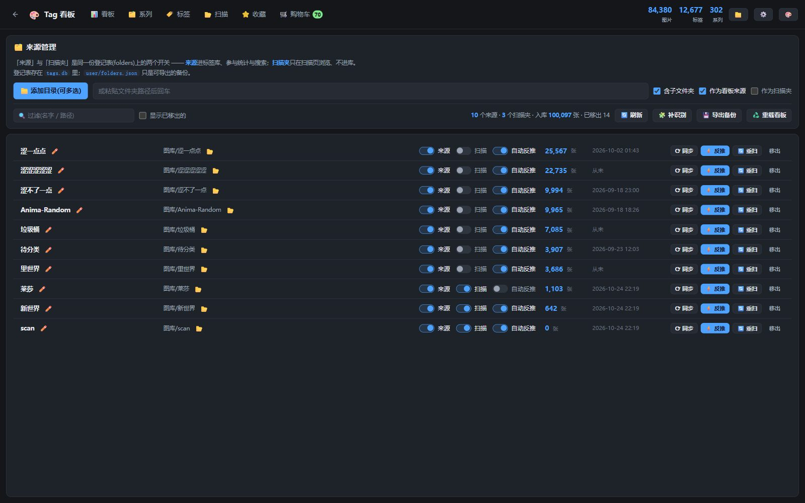</td>
  </tr>
  <tr>
    <td align="center" colspan="2"><b>扫描页：文件夹库两级浏览，封面被安全模式藏掉时给盾牌占位而不是白块</b><br/>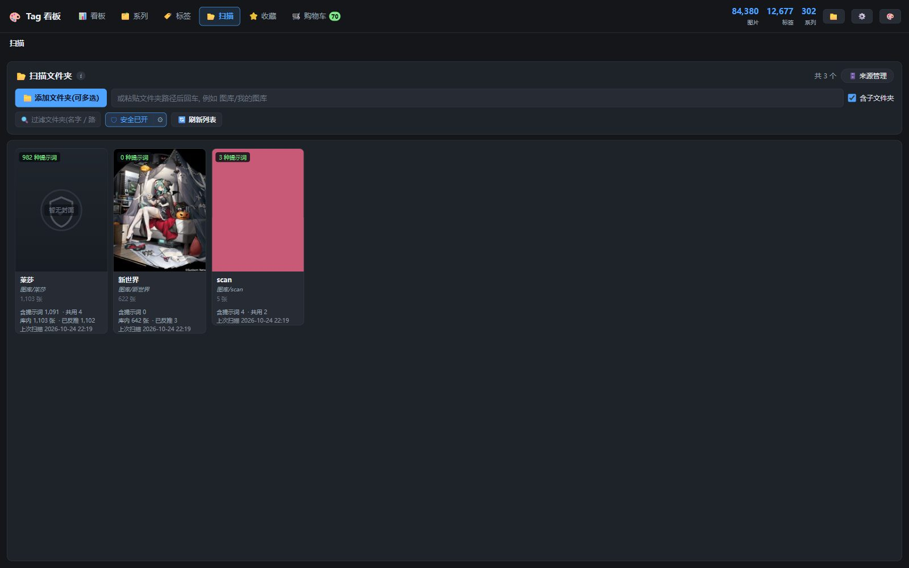</td>
  </tr>
</table>

---

## 主线：一张图会经历什么

```text
①  本地图片文件夹
        │   扫描入库：有元数据直接解析，没有就 WD14 反推
        ▼
②  tags.db ── 标签 · 角色 · 系列 · 收藏 · 规则
        │   看板 / 系列 / 标签逐层下钻 → 光箱看图
        ▼
③  角色购物车 ── 组队 + 附加标签 + 清单
        │   导出管线（10 步，顺序固定）
        ▼
④  ComfyUI wildcard ──▶ 抽卡出图 ──▶ 新图回流到 ①
```

第 ④ 步那条回头箭头是项目的核心：**出图产生新图 → 新图入库 → 标签库变大 → 下一次导出选择更多**。同一套标签抽十次能出十张不同的图，挑出满意的那张再反推一次，就得到一套「进化过」的标签。

---

## 四条主流程

### 1. 入库与反推：图片怎么变成可搜的标签

```text
添加来源（递归 · 看板用 · 扫描用）
   ↓  流式扫描：扫到首批就能进界面，可取消，进度推到顶栏
PNG 里带 prompt / workflow 元数据吗？
   ├─ 带   → 直接解析原始提示词（自己生成的图，零误差）
   └─ 不带 → WD14 反推打标（收集来的图）
   ↓
写入 tags.db
   ↓  缺角色 / 系列？→ 孤儿补识别：只追加，不动已有标签
建系列 · 角色索引
   ↓
自动挑封面（安全感知 + 最接近 3:4 的真竖图）
```

- **元数据优先，反推兜底**：两条路的结果都进同一张库，之后不再区分来源。
- **反推只补角色 / 系列**：孤儿补识别不会覆盖你已有的标签，只往缺的地方加。
- **封面会自愈**：扫描夹里的图被删或移走后，封面会按对账结果换一张，不会留白块。

<table>
  <tr>
    <td align="center" width="50%"><b>扫描页：登记进来的文件夹库，两级浏览</b><br/></td>
    <td align="center" width="50%"><b>来源管理：来源 / 扫描夹两个开关 + 图数 + 一键反推</b><br/></td>
  </tr>
</table>

### 2. 找图与下钻：几万张里怎么定位

```text
顶栏「标签」→ 列表（搜索 · 仅收藏 · 隐藏已 ban · 安全过滤 · 来源|扫描范围）
   ↓  点一个标签
就地叠一层「标签图集」── 不换页，顶部页签不动
   ↓  点一张图
光箱：翻页 / 缩放 / 双标签源 / 按配置复制 / 入车 / ban
   ├─ 点角色·系列药丸   → 再叠一层：这个系列的角色名单
   ├─ 点「库内命中」徽章 → 再叠一层：全库最像这张的图
   └─ 点路径栏最左箭头  → 退一层，刚才那张大图原样拉回来
```

- **就地叠层，不换路由**：在看板 / 系列 / 扫描 / 标签页里点标签，是在当前页上叠一层；每一层独立记住自己的筛选和勾选。
- **返回不重来**：退层会把你刚才正在看的那张大图原样恢复，不是关掉重开。
- **光箱是工作台**：所有单图动作都在这里，不用回到列表页再找。
- **库内命中**：剥掉角色和机位标签后按 IDF 加权 Jaccard 打分，找「最像这张」的同款构图 / 服装。

<table>
  <tr>
    <td align="center" width="50%"><b>标签总表：中英对照 + 命中数，支持「隐藏已 ban」</b><br/></td>
    <td align="center" width="50%"><b>点标签后就地叠的图集：还能再按来源收窄</b><br/></td>
  </tr>
  <tr>
    <td align="center" colspan="2"><b>光箱：这张图身上就能 ban 词、入车、按配置复制</b><br/></td>
  </tr>
</table>

### 3. 组队与导出：角色怎么变成 wildcard

```text
四个入口：角色卡 🛒 ┆ 标签药丸 🛒  光箱 ┆ 图片详情页
   ↓
购物车（全站抽屉，任何视图都能拉开）
   ↓  附加标签 · 换封面 · 缩略图自愈
四条出路：⬇ 导出 txt ┆ 📋 复制 ┆  存为清单 ┆  自动导出
   ↓  导出 txt / 自动导出走同一条管线
导出管线 10 步 → 分块写 + 临时文件原子改名 → ComfyUI wildcard
```

- **附加标签必须同行**：给角色加 `closed_eyes` 时，导出是 `columbina \(genshin impact\), closed eyes`，不是另起一行 —— 否则 wildcard 会抽到「只有闭眼没有角色」的空 prompt。
- **清单 = 队伍的存档**：攒好的角色组合存成清单，下次一键切回，不用重一个个点。
- **两套自动导出**：看板预设跟「黑名单内容变化」走；购物车自动导出跟「购物车内容指纹」走。都带延迟合并，连续改十次只导一次。
- **清空购物车不会导出**：防止「导出 → 存清单 → 自动清空」顺手把下游文件清成空的。

<table>
  <tr>
    <td align="center" width="50%"><b>系列里的角色页：卡片右上角收藏，「...」里 ban</b><br/></td>
    <td align="center" width="50%"><b>购物车：按系列分组、附加标签、存为清单</b><br/></td>
  </tr>
  <tr>
    <td align="center" colspan="2"><b>导出预设：把一套筛选存下来，配自动导出</b><br/></td>
  </tr>
</table>

### 4. 整理与纠错：把库修干净

```text
全库图片
   ↓  稀有标签倒排（df ≤ 50，至少共现 3 个罕见标签）
IDF 加权 Jaccard 打分
   ↓  阈值分组（默认 0.85，可选 0.65–0.95；并查集，最多 2000 组）
保留规则排序（画师 / 创建时间 / 体积 / 分辨率 / 图内元数据 / 文件名）
   ↓  人工审核
删其余 ┆ 标非重复 ┆ 删记录（永久忽略：只删记录，不删图）
```

- **查重是可解释的**：每组会标出「为什么建议保留这张」；误报可以永久拉黑，也能一键全部恢复。
- **角色可以纠正**：显示名、所属系列、屏蔽，全部存在用户层，压过自动识别，但不改图片上的标签。
- **分类可以自己定**：系列归类、自定义分类、补充角色、隐藏分类、屏蔽角色，四个页签一次改完。
- **标签本身能改**：改名是全库逗号 token 精确替换，不会误伤包含它的长标签；删除可以圈一个范围标签，只删同时含两者的图。改之前能预览命中数，写之前自动备份 `tags.db`。

<table>
  <tr>
    <td align="center" width="50%"><b>查重面板：一组差分图 + 为什么保留这张 + 已忽略页签</b><br/></td>
    <td align="center" width="50%"><b>替换规则：左侧多套规则组，底部实时测试条</b><br/></td>
  </tr>
</table>

---

## 导出管线：10 步，顺序不能换

```text
① 剔角色·系列 → ② 剔视角·机位 → ③ 只留安全 → ④ 黑名单 → ⑤ 替换规则
⑥ 权重去重   → ⑦ 补背景     → ⑧ 段位重排 → ⑨ 下划线转空格 → ⑩ 带路径
```

| 步骤 | 做什么 | 为什么在这个位置 |
| --- | --- | --- |
| ① | 剔除角色 / 系列标签 | 角色由 wildcard 那行负责，行内再带会重复 |
| ② | 剔除视角 / 机位标签 | `from behind`、`high angle` 这类词常和构图打架 |
| ③ | 只导出安全标签 | 按 core / edge / 跟随全局口径，逐 tag 剔除，不删行 |
| ④ | 黑名单 | 精确 / 前缀 / 后缀 / 包含 / 整段 `@x@` 五种写法 |
| ⑤ | 替换规则 | 规则可能新增标签，所以必须在黑名单之后、去重之前 |
| ⑥ | 权重壳去重 | `(tag:1.2)` 按裸词判重，避免同一个词带不同权重进两遍 |
| ⑦ | 缺背景补背景 | 只有确定缺背景时才追加，避免覆盖已有场景 |
| ⑧ | 段位模式重排 | 画师 / 角色 / 系列 / meta / 通用归堆，供绘图管线随机抽注入 |
| ⑨ | 下划线转空格 | ComfyUI 的习惯写法；中英文标点不受影响 |
| ⑩ | 每行带图片路径 | 可选，给需要溯源的下游用 |

**落盘方式**：每 1000 行让出一次事件循环，先写临时文件再原子改名 —— 下游读到的永远是完整文件，不会读到半截。

---

## 功能全景

按 12 个功能域展开。每一项都在当前代码里真实存在；括号里是容易忽略的约束。

### 1. 启动 · 外壳 · 导航

- 单实例锁：二次启动只聚焦已有窗口，不会开两个实例抢数据库。
- 数据目录四级解析：`settings.json` → `TV_DATA_DIR` → 应用同目录 `data/`（绿色包随包走）→ `%APPDATA%/TagViewer/data`。
- 启动兜底：数据目录为空 / 读不到时弹一键引导（当场登记文件夹），不白屏、不静默失败。
- 顶栏 6 个主页签：看板 / 系列 / 标签 / 扫描 / 收藏 / 购物车。
- 4 条二级路由：来源管理、图片详情、库内命中、标签图集。
- 路径栏面包屑：每一级都能复制完整路径，最左箭头回上级。
- 顶栏返回箭头：只在没有路径栏、且不是根页时出现，避免和路径栏打架。
- 就地叠层：标签图集 / 系列角色 / 库内命中不换路由，顶部页签不动。
- 光箱返回记忆：`rememberJump` / `takeJump`，退层后回到原图位置。
- `smartBack` 智能返回：按来路决定退到哪，不硬编码首页。
- 主题切换：7 套配色（护眼绿 / 浅色 / 纸墨 / 蜜桃 / 薰衣草 / 深色 / 深海蓝），默认深色，选择持久化。
- 数据集统计条：图 / 标签 / 角色 / 系列 / 体积。
- 浮动导航键：回顶 / 购物车 / 随机，右侧竖排。
- 14 条主进程推送：扫描、反推、导出、购物车自动导出等进度统一进角标。
- 全局单例弹窗：设置、规则编辑器、安全模式、回收站确认、Toast。

### 2. 看板

<p align="center"><br/><sub>来源胶囊（带每个来源的图数）· 🛡 安全模式 · 无限滚动的真比例网格</sub></p>

- 多词胶囊搜索：敲逗号把当前词定格成胶囊，接着联想下一个；下拉里能「全选」当前词匹配到的所有标签。
- 组合模式 `any / all`，匹配方式 `contains / exact`。
- 深度链接：从标签页 / 查重 / 系列页带条件跳回，筛选不丢。
- 文件名过滤、来源 chips 多选（带每个来源的图数）、高频标签 / 高频系列侧栏。
- 只看 ComfyUI 生成的图：按图内嵌元数据判来源，比按文件名猜靠谱。
- 安全模式过滤：被藏空时可以手动「继续拉下一批」。
- 选择模式：勾选 / 全选本批 / 反选；Ctrl+点击、Shift 区间选、Ctrl+A、Delete、Esc。
- 批量：收藏 / 取消收藏、入购物车、移动、复制、删除（走回收站）。
- 无限滚动网格：justified rows + 真实像素比，横图不再被裁成竖条。
- Ctrl+滚轮缩放 0.45×–2.25×，比例记忆；底部百分比徽标停手淡出，点一下回 100%。
- 🎲 随机洗牌；导出分体按钮（纯标签 / 带路径）。
- 剔除视角标签、套用替换规则（可选规则组）、导出预设入口、🔎 查重入口。
- 图片卡：来源徽章、相似度徽章、收藏按钮、缺失态、上次浏览呼吸框、500ms 长按进选择、原生右键菜单。

### 3. 看图 · 光箱

<p align="center"><br/><sub>中英双标签、命中黑名单提示、逐 tag 复制 / 入车 / ban 都在这一个界面</sub></p>

- 键盘：Esc 关闭、←→ 翻页、PgUp / PgDn 跳、Del 删除、1–9 快速移动归档。
- 滚轮翻页：55px 阈值 + 190ms 防抖，不会一滑十张。
- Ctrl+滚轮缩放 0.25×–6×，双击复位。
- 双标签源：本地标签库 / 图内原始元数据；原始词会先去库里匹配，命中的带图片数并可直达。
- 分类分组显示、命中 / 未命中胶囊、库内命中徽章。
- 角色 / 系列药丸；系列药丸就地叠一层该系列角色列表。
- 复制按钮带过滤面板（勾选状态会记住）：去 ban / 剔角色·系列 / 剔视角·机位 / 套用替换规则（可选规则组）/ 只复制安全标签（跟随全局 / core / edge）—— 与导出同一套过滤原语。
- 单标签操作：复制 / 入购物车 / ban；可切换「显示被 ban 标签」。
- 收藏 / 取消收藏、背景补全预览、路径复制、资源管理器定位、快捷移动条。
- 控件自动隐藏；缺失文件给出提示并支持重新定位。
- 缩略图 4 并发、原图 2 并发，失败重试并逐档降级。

### 4. 系列浏览

<p align="center"><br/><sub>作品墙：分类页签 + 搜索（中英文）+ 每张卡上的角色数 / 图数</sub></p>

- 三级视图：系列 → 角色 → 图片，全部就地叠层。
- 分类页签：游戏 / 动漫 / Vtuber / 其他 + 自定义分类；隐藏分类默认不显示，数据仍在。
- 系列搜索支持英文与中文翻译；有「无图角色」视图。
- 分类管理 4 页签：系列归类、补充角色、隐藏分类、屏蔽角色（可恢复）。
- 自定义分类新增 / 删除；删除时该分类下的系列回落到「其他」。
- 角色卡：🛒 入车、✏️ 纠正（显示名 / 挪系列 / 屏蔽）、🖼 换封面、ban 确认弹窗。
- 自定义封面「本地图」：候选按当前来源过滤，安全模式开着时只出安全图，当前封面有标记。
- 自定义封面「网上挑」：Danbooru / Safebooru，支持分级 g/s/all、只要单人图、分页续拉。
- 网上挑只下载站点展示尺寸，落到 `data/char_covers/user_picks/`，**不进标签库**。
- 恢复自动挑选；自动判据是「安全感知 + 最接近 3:4 的真竖图」。
- 角色排序 / 多选 / 批量收藏与入车；系列封面批量面板；系列内图片级批量操作。

### 5. 标签库

<p align="center"><br/><sub>标签总表：中英对照 + 命中数；点一个词就在当前页上叠一层图集</sub></p>

- 标签列表无限滚动，中英文搜索。
- 隐藏已 ban 标签开关（默认藏，记忆在本地）、仅看收藏、安全过滤、来源 | 扫描范围切换。
- 标签图集页 `/tags/:tag`：就地叠层、排序（路径 / 最新 / 随机）、页大小 60 / 120 / 240。
- 图集内批量：选择、移动、复制、收藏。
- 标签改名：全库逗号 token 精确替换；同步 tags 总表 / 翻译 / 角色库；新名带 `xxx_(系列)` 会自动识别成角色并归系列。
- 标签删除：可留空全删，也可填一个范围标签，只删同时含两者的图。
- 改前预览命中数，写前自动备份 `tags.db`，事务写入。

### 6. 扫描 · 来源

<p align="center"><br/><sub>来源管理：同一个文件夹可以「进标签库」也可以「只拿来浏览」，两个开关各管一头</sub></p>

- 添加文件夹来源：递归 / board 标记 / scan 标记。
- 流式扫描 + 实时进度行，可取消。
- 8 种排序：名称↑↓ / 文件夹 / 时间↑↓ / 体积↑↓ / 标签数。
- 窗口化分页：只渲染当前页，大文件夹不卡；文件夹级 / 图片级两级浏览。
- 筛选历史、安全计数、重新扫描。
- 来源内标签页：就地看这个来源的标签，不跳走。
- 移动 / 复制弹窗、显示已移除、刷新、重载 board。
- 孤儿补识别：只追加角色 / 系列，不动已有标签。
- 登记表本身存在 `tags.db`，可另外导出备份到 `user/folders.json`。
- 来源行操作：重命名、⟳ 同步、⚡ 反推、移出、恢复、彻底清除（二次确认）、♻️ 重载看板。
- 扫描夹封面自愈：列表置空、对账重挑、删移即清。
- 缺失文件解析；删除走回收站，可还原。

### 7. 收藏

- 收藏标签过滤、安全过滤、网格 + 光箱、一键取消收藏、缺失文件重新定位。

### 8. 购物车 · 清单

<p align="center"><br/><sub>购物车：按系列分组，附加标签和导出都在这页；封面被安全模式挡掉时给占位而不是白块</sub></p>

- 全站抽屉：任何视图都能拉开；另有独立购物车页。
- 按系列分组，组内按角色名排序；四个加入入口：角色卡 / 标签药丸 / 光箱 / 详情页。
- 缩略图自愈：加载失败轮换候选、横图自动换最接近 3:4 的竖图、无封面补挑。
- 安全模式换图只换显示、不写回；关掉安全模式原图就回来。
- 中文名兜底：入车时存的是英文短名，显示时现查翻译库。
- 附加标签：导出时拼在同一行，编辑时实时预览该行效果。
- 换封面复用封面挑选弹窗，系列页角色卡同步换；恢复自动挑选后重新补挑。
- 移除单条 / 清空（二次确认）。
- ⬇ 导出 wildcard txt、📋 复制整份到剪贴板。
- 💾 存为清单：命名（默认时间名）、可顺便导出、可选存完清空。
- 📁 我的清单：载入 / 重命名 / 删除 / 当前清单标记。
- ⚙ 自动导出：开关、状态、目录、文件名、延迟、立即导出、跳过等待、上次结果。
- 状态徽标：绿 = 已同步，橙 = 待导出，带 mm:ss 倒计时。
- 清空购物车不触发导出。

### 9. 导出管线 · 预设

<p align="center"><br/><sub>导出预设：一套筛选快照 + 目标目录 + 自动导出，点一下就把整批重导一遍</sub></p>

- 入口：看板导出、导出预设、购物车、清单。光箱的「复制标签」复用同一套过滤原语（视角 / 安全 / 替换），但只进剪贴板、不写文件。
- 筛选快照：来源多选、搜索词、组合与匹配、排除词、排除词命中带括号标签。
- 10 步管线见上一节；可选规则组、安全剔除口径（follow / core / edge）、每行带路径。
- 分块写入（1000 行一批）、临时文件 + 原子改名、非法文件名字符替换、60 字截断。
- 导出预设 = 筛选快照 + 目标目录 / 文件名 + 自动开关。
- 目录优先级：全局默认 > 上次选的 > 数据目录；最近目录保留 8 个。
- 全局 ban 延迟：1.5s / 30s / 60s / 180s（默认）/ 300s / 600s。
- 自动导出只在黑名单内容真变化时触发，等待期间合并；点击首页「待导出」角标可跳过等待。

### 10. 规则 · 安全 · 分类

<p align="center"><br/><sub>替换规则构建器：每张卡第一行就是这条规则的导出结果，左边可以存多套规则组</sub></p>

- 黑名单语法：精确 `red_hair`、前缀 `blue_*`、后缀 `*_hair`、包含 `*color*`、整段 `@boy@`、`#` 注释。
- 替换规则多组：新建 / 改名 / 复制 / 设为默认 / 删除（删除用页内二次确认，不弹原生窗口）。
- 构建器：每条规则一张两行卡，第一行是**导出结果预览**（所见即所得），第二行是原标签三态 + 替换标签。
- 原标签三态：丢弃 / 保留（可加 `_art` 这类后缀）/ 删除标签。
- 来源 tag 可合并：同一张卡共用一套替换结果。
- 替换标签带联想（中文 + 图片数）；支持社区写法 `(tag:1.2)`，点 chip 调权重，0.1–2.0 步进，1.0 自动去壳。
- 分组注释（`#` 开头，保存时写在规则前 / 后）、语法帮助浮层、实时测试条（走后端，与导出引擎同一套代码，但测的是**已保存**的规则）。
- 原文模式：批量粘贴、特殊符号、构建器表达不了的 raw 行。
- 保存不关窗，立即生效；默认组决定导出时不特意选组用哪套。
- 安全模式：默认关闭；安全 / 不安全取反；core / edge 两档；全库命中统计；标签增删 + 原始文本编辑（支持 `*` 通配）。
- 分类管理：系列归类 / 补充角色 / 隐藏分类 / 屏蔽角色。

### 11. 查重 · 库内命中

<p align="center"><br/><sub>查重面板：一组疑似重复并排摆出来，★ 那格写着「为什么建议留这张」</sub></p>

- 查重入口在看板动作区；稀有标签倒排（df≤50、共现≥3）+ IDF 加权 Jaccard。
- 7 档阈值 0.65–0.95（默认 0.85）；并查集分组，最多 2000 组。
- 保留规则：画师 / 创建时间 / 文件大小 / 分辨率 / 图内元数据 / 文件名特征；文件夹优先级可拖拽排序。
- 相似组 / 已忽略双页签；每页 12 组自动加载 + 回到顶部。
- 组内操作：非重复 / 删其余 / 恢复这组 / 删记录（永久忽略）；★ 显示保留理由，带排名徽章。
- 永久忽略底部有一键全部恢复；组内缩放 120–900px；跨组光箱 + 退出回到该组。
- 库内命中：去角色 / 机位后比对，阈值 0.4（可 0.2–0.6），0 命中可放宽到 0.2，8 条缓存。
- 结果显示相似度 %，来源 | 扫描范围，无限 60；支持批量入车 / 收藏 / 移动。

### 12. 反推 · 设置 · 数据 · 打包

<p align="center"><br/><sub>设置抽屉：反推环境、在线封面 Key（只显示掩码）、外部程序清单；长说明全收进 ⓘ 里</sub></p>

- 反推预设：`auto` / v0.9 / v1.0 / v1.0-336 / v1.0-672。
- v0.9：13,461 个标签、448px（默认、稳定）；v1.0：30,877 个标签、1008px（角色词表约 2.3 倍，CPU / DirectML 上明显更慢）。
- v1.0-336：336px 微调，实测 DirectML 约 0.17 秒/张（CPU 约 5.8 秒），角色召回略低于 1008；v1.0-672：实测 CUDA 约 0.26 秒/张，DirectML 反而要约 14 秒，只在 N 卡环境推荐。
- 阈值：通用 0.35 / 角色 0.85；执行后端 auto 按 CUDA > DirectML > CPU 选择。
- 推理环境首次运行下载约 1.4GB，支持断点续传，右下角有进度卡。
- 设置 · 反推环境：后端 / onnxruntime / 模型 / provider / 阈值 / Python。
- 设置 · 在线封面：Danbooru 状态、掩码显示的 API Key、保存 / 测试 / 清除。
- 设置 · 外部程序清单：右键「用其他程序打开」的候选，可增删。
- 设置 · 通用：分组标签、版本、更新。
- 内置数据：16,558 条翻译、3,457 条分类、13,461 行的 WD14 词表。
- 数据路由 K / U / R / D：知识库、用户层、规则层、派生层，互不混写。
- 安全边界：API Key 只存在主进程 `booru_auth.json`，渲染层只拿掩码。
- IPC：127 个白名单通道、14 条推送，统一 `safe()` 包装，数据通道额外 `gated()`。
- 打包：NSIS 安装器 + 90MiB 分片 + 引导安装器；绿色包 full / basic / lite 三种。
- 更新：Gitee 分片更新器。
- 验证：构建前预检 6 项守卫（导入路径 / 具名导出 / IPC 白名单 / 启动脚本编码 / 模板未定义绑定 / 盘符绝对路径）、真实 Electron + CDP 的 e2e（当前 442 项断言全绿）、20 条 `test:*` 脚本、30 秒 smoke。

---

## 页面与路由

| 页面 | 主要用途 | 典型入口 |
| --- | --- | --- |
| 看板 Home | 全库搜索、来源筛选、批量操作、查重入口 | 启动默认页 |
| 系列 Series | 作品 → 角色 → 图片，角色纠正与封面 | 顶栏 |
| 标签 Tags | 标签总表、ban、收藏、标签图集 | 顶栏 / 光箱 |
| 扫描 Scan | 文件夹库、排序、移动归档、来源内标签 | 顶栏 |
| 收藏 Favs | 标星图片的快速回看 | 顶栏 |
| 购物车 Cart | 角色组、清单、自动导出 | 顶栏 / 抽屉 |
| 来源管理 `/sources` | 登记 / 移除 / 彻底清除、孤儿补识别 | 扫描页 |
| 图片详情 `/detail` | 单图标签全貌与复制 | 右键 / 光箱 |
| 库内命中 `/meta-hits` | 同款构图检索 | 光箱徽章 |
| 标签图集 `/tags/:tag` | 从任意入口直达某个标签 | 深链 / 系列药丸 |

---

## 数据、隐私与网络边界

### 数据目录

| 优先级 | 来源 | 说明 |
| --- | --- | --- |
| 1 | `settings.json` 的 `dataDir` | 真实设置文件在 `<userData>/settings.json`（Windows: `%APPDATA%\TagViewer\`） |
| 2 | 环境变量 `TV_DATA_DIR` | 适合脚本 / 多套数据切换 |
| 3 | **与应用同目录的 `data/`**（portable） | 存在且可写就用它 —— **绿色包的数据随包走**（删文件夹即卸载）；仓库开发态同样命中 |
| 4 | `<userData>/data` | 以上都没有时的默认值，一定是可写目录 |

### 数据分四层

| 层 | 内容 | 会不会离开本机 |
| --- | --- | --- |
| **K 知识** | 16,558 条翻译、3,457 条分类、WD14 词表（随包）；角色 / 系列推导规则；你自己的补译 / 角色映射 | 随包部分随安装包分发；补充文件不出机器 |
| **U 用户** | `user_meta.json`、`user/user_covers.json`、清单、导出预设、纠正层、安全开关 | **绝不出机器** |
| **R 规则** | 黑名单、替换规则组、安全标签集合、查重忽略表 | **绝不出机器** |
| **D 派生** | `tags.db`、扫描缓存、缩略图、反推结果 | 不进仓库；内嵌本机路径 |

### 网络行为

- **默认全程离线**。只有三个动作会联网：下载反推运行环境、设置里测试 Danbooru Key、你主动点「网上挑封面」。
- Danbooru / Safebooru 只在你点搜索时请求；挑中的图下载到本地封面目录，**不进标签库**。
- API Key 只存在主进程，渲染层拿不到明文，界面只显示掩码。
- 删除走回收站；「移出来源」只注销，不动文件；「彻底清除」才删库里的记录。

---

## 快速开始

### 三种装法

1. **安装包（推荐）**：到 [Gitee Releases](https://gitee.com/klanf/tag-viewer/releases) 下载
   - **引导安装器**（<1MB）：自动从 Release 拼包安装，不用手动下 110MB；
   - 或完整安装包 `TagViewer-Setup-x.y.z.exe`。
2. **绿色包**：解压，双击「启动看板.bat」或「启动看板.vbs」（不弹黑框），什么都不用装。
   三种变体：**full**（模型 + 环境全带）、**basic**（不带 1.27GB 模型）、**lite**（模型和 Python 都不带，只带应用本体）。
3. **从源码跑**：

```bat
npm install        :: 会复用本机已有的 Electron 运行时，不重复下载
npm run build      :: 预检 + 构建前端到 dist/
npm start          :: 启动（等价于双击启动脚本）
```

> `npm install` 复用运行时的逻辑在 `scripts/local-config.mjs`；找不到才回退官方下载。也可以写 `local.config.json`（模板 `local.config.example.json`），该文件不进仓库。

### 五步走通第一条链路

1. **登记文件夹**：扫描页 → 右上角「🗄️ 来源管理」→ 添加目录（可勾递归）。
2. **等扫描**：进度条走完，看板就有图了；没有元数据的图会提示是否反推。
3. **反推（可选）**：第一次会下载约 1.4GB 运行环境，之后全程本地；无角色 / 系列的图可单独补识别。
4. **找一张图**：看板搜标签 → 点开光箱 → 切「图内元数据」看看原始词。
5. **组队导出**：系列页点角色卡 🛒 → 购物车导出 txt → 丢进 ComfyUI。

---

## 常用设置

| 想调什么 | 在哪 | 说明 |
| --- | --- | --- |
| 反推模型 / 阈值 / 后端 | 设置 → 反推环境 | 追求速度选 336，追求召回选 v1.0 |
| Danbooru API Key | 设置 → 在线封面 | 填了才能用站方人气排序、放开标签数量限制 |
| 安全模式档位与集合 | 顶栏 🛡 / 各页开关 | 默认关闭；面板里能看到「会隐藏多少张」 |
| 黑名单 / 替换规则 | 看板「🚫 / 🔁」入口 | 替换规则支持多组，导出时选组 |
| 导出预设与自动导出 | 看板「📤 预设导出」 | 预设存的是筛选快照，不跟首页联动 |
| 购物车自动导出 | 购物车抽屉「⚙ 自动导出」 | 默认延迟 30 秒，指纹变化触发 |
| 外部程序 | 设置 → 外部程序 | 右键「用其他程序打开」的候选清单 |
| 分类与角色纠正 | 系列页「⚙ 分类管理」/ 角色卡 ✏️ | 自定义分类、补充角色、屏蔽角色 |

---

## 常见问题

**Q：为什么第一次反推要下 1.4GB？**
A：推理环境 = Python + ONNX Runtime + 模型。只下一次，之后离线跑；支持断点续传，下载失败重进会接着下。

**Q：为什么清空购物车没有触发自动导出？**
A：故意的。否则「导出 → 存清单 → 自动清空」这条常用流程会把下游 wildcard 文件清成空的。

**Q：为什么把来源「移出」后图还在？**
A：「移出」只是注销来源，图和记录都还在；要删记录得用「彻底清除」。

**Q：为什么有些标签搜不到中文？**
A：翻译库是 16,558 条，冷门角色 / 新番可能没收录。可以在用户层补译；缺失时搜索仍可用英文原词。

**Q：为什么封面变成了白块？**
A：原封面文件被删 / 移走了。扫描夹封面会自动对账重挑；自定义封面需要手动换一张或恢复自动挑选。

**Q：网上挑封面搜不到图 / 很慢？**
A：这两个站从国内访问时通时断；匿名访问 Danbooru 一次最多带 2 个普通标签，且站方人气排序不生效。填 API Key 后两处都放开；Safebooru 不需要 Key。

**Q：查重把两张不像的图分到一组？**
A：调高阈值，或把「保留规则」换成更符合你习惯的判据；误报组可以「删记录」永久拉黑，只删记录不删图，底部能一键恢复。

**Q：支持 macOS / Linux 吗？**
A：目前只做 Windows x64。路径处理、缩略图、安装器、分片更新都按 Windows 实现。

**Q：会把我库里的图上传吗？**
A：不会。除了你主动触发的「下载运行环境 / 测试 Key / 网上挑封面」，没有任何出站请求。

---

## 已知边界

| 项 | 现状 |
| --- | --- |
| 平台 | 仅 Windows x64 |
| 光箱缩放 | Ctrl+滚轮放大后只能看中心区域，还没有拖拽平移 |
| 数据目录切换 | 支持 `TV_DATA_DIR`，UI 里还没有入口 |
| 一级文件夹列表 | 按最近扫描时间排（失效的沉底），不能手动排序；图片级有 8 种排序 |
| 查重永久忽略 | 只有整批「全部恢复」，没有单独列出被忽略的组 |
| 就地标签页 | 看板 / 系列 / 扫描 / 标签页生效；收藏与购物车仍走独立标签页 |
| 多人协作 | 无账号、无云同步，设计上就是单机单人 |
| 标签中文覆盖 | 16,558 条，冷门词仍会显示英文原词 |

---

## 开发与验证

### 架构

- **主进程** `electron/`：数据库、扫描、反推、导出、封面、查重、IPC、`tv://` 协议、更新器。
- **渲染进程** `src/`：Vue 3 `<script setup>` + Pinia + vue-router（hash）。
- **边界**：渲染层只通过 preload 白名单调主进程；文件路径不直接暴露给页面；API Key 不进入渲染层。
- **共享面板**：`TagImagesPanel` / `TvSeriesCharsPanel` / `MetaHitsPanel` 一套实现，多个宿主复用，避免同一个功能两处漂移。

### 常用命令

| 命令 | 作用 |
| --- | --- |
| `npm start` | 启动构建好的版本 |
| `npm run dev` | Vite dev server + Electron 热更新 |
| `npm run check` / `npm run build` | 静态预检 / 预检 + 构建 |
| `npm run smoke` | 30 秒冒烟：起一个实例，报告落在哪个视图、有无 JS 报错 |
| `npm run e2e` | 全量端到端断言（真实 Electron over CDP） |
| `npm run selftest` | 一键自检 |
| `npm run db:info` / `db:verify` | 看标签库现状 / 逐条比对库与 txt |
| `npm run data:backup` | 给 `tags.db` 打一份带日期的备份 |
| `npm run pack:green` | 打绿色分发包（可加 `--variant basic` / `lite`） |
| `npm run dist` | 打 NSIS 安装包 |

> 其余 `db:import` / `txt:archive` / `test:*` / `backfill:dims` / `prune:dist` 等几十条命令，
> 以及启动时序、IPC 契约、踩坑记录，都在 [docs/开发手册.md](docs/开发手册.md)。

### 验证方式

- 每次改动先跑 `npm run check`（6 项预检守卫）。
- e2e 用隔离的 `.e2e-work` 数据副本，不碰真实库；真实 `data/tags.db` 只读。
- 当前回归 442 项断言全绿；新增交互必须补对应断言。
- 前端改动必须实际在 Electron 里点过，不以「构建通过」当功能验证。

---

## 许可证

MIT。翻译与分类源数据的来源与授权现状见 [knowledge/README.md](knowledge/README.md)。

如果这个工具帮你省下了找图和拼词的时间，欢迎在 [Gitee](https://gitee.com/klanf/tag-viewer) 点个 Star。
